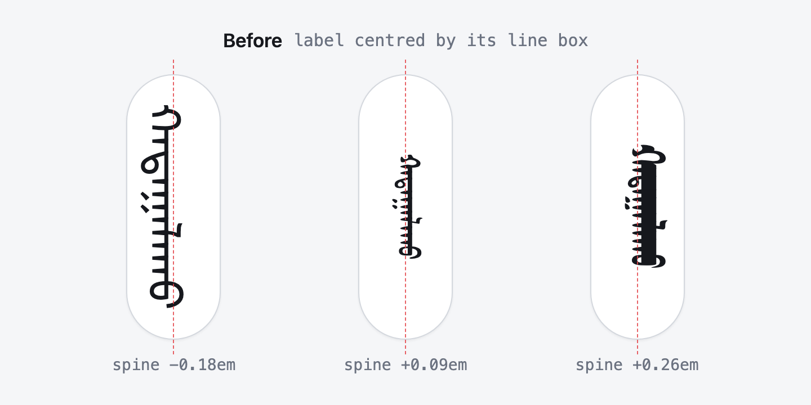

# vertical-ui

A spec, CSS and web components for user interfaces in vertical text on the
web, starting with traditional Mongolian script (Mongol bichig).

Mongolian text hangs from a spine, not a baseline, and its columns run left to
right. Most web layout assumes neither. This project writes down the rules
that keep vertical interfaces aligned and readable, in a form people and code
agents can both apply, and ships the small amount of code the rules need.



The same button in three fonts. Centring the label's line box leaves its stem
off the middle by a different amount in each font; `.vui-spine-centered`
shifts it by the spine offset `applySpine()` measured. See
[spec/spine.md](spec/spine.md).

- **[spec/](spec/README.md)**: one page per problem, each with rules, minimal
  code, a geometry test and a browser status.
- **`@gege-mn/vertical-ui`**: CSS plus two framework-free web components, in
  light DOM so page fonts and styles reach them.
- **[skills/vertical-ui](skills/vertical-ui/SKILL.md)**: the spec as an agent
  skill. [llms.txt](llms.txt) indexes it for other tools.

Status: 0.1, the layout core. Verified in Chromium; Firefox and Safari are
untested. See [ROADMAP.md](ROADMAP.md).

## Install

```sh
pnpm add @gege-mn/vertical-ui
```

## Use

```ts
import '@gege-mn/vertical-ui/vertical-ui.css';
import '@gege-mn/vertical-ui/define'; // registers <vui-text> and <vui-scroller>
import { applySpine } from '@gege-mn/vertical-ui';

await document.fonts.ready;
await applySpine(); // sets --vui-spine for the Mongolian font
```

```css
:root {
  --vui-font-mongolian: 'Your Mongolian Font', sans-serif; /* the library names no font */
}
```

```html
<vui-scroller>
  <section>
    <vui-text lang="mn-Mong" text="…"></vui-text>
  </section>
</vui-scroller>
```

| Export | What it does |
|---|---|
| `vertical-ui.css` | `.vui-mongolian`, run classes, `.vui-spine-centered`, `.vui-on-spine`, scroller base (all in `@layer vui`) |
| `<vui-text>` | Vertical text that turns each run (digits, Latin, CJK) the right way |
| `<vui-scroller>` | Horizontal canvas; maps the mouse wheel and keys sideways |
| `orientRuns()` | Text split into runs with an orientation each, ready for any framework to render |
| `segment()`, `orient()` | The two steps under `orientRuns()` |
| `measureSpine()`, `applySpine()` | A font's spine offset, written to `--vui-spine` |
| `/debug` → `showSpines()` | Development aid: draws every vertical Mongolian column's measured spine |

The main entry is safe to import during server rendering. The elements live
in `@gege-mn/vertical-ui/elements` (classes) and `/define` (registers them),
which need a browser.

## Development

```sh
pnpm install
pnpm test && pnpm typecheck && pnpm lint
```

Never type invisible characters (MVS, NNBSP, FVS, ZWJ, nirugu) as literals;
use `\u` escapes in code and `U+XXXX` in prose. The test suite enforces it.

## Licence

MIT
